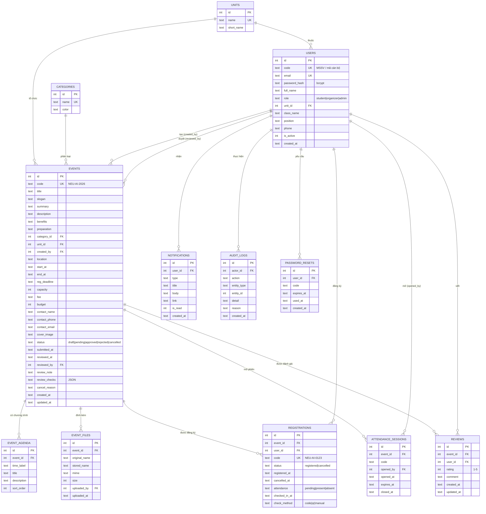
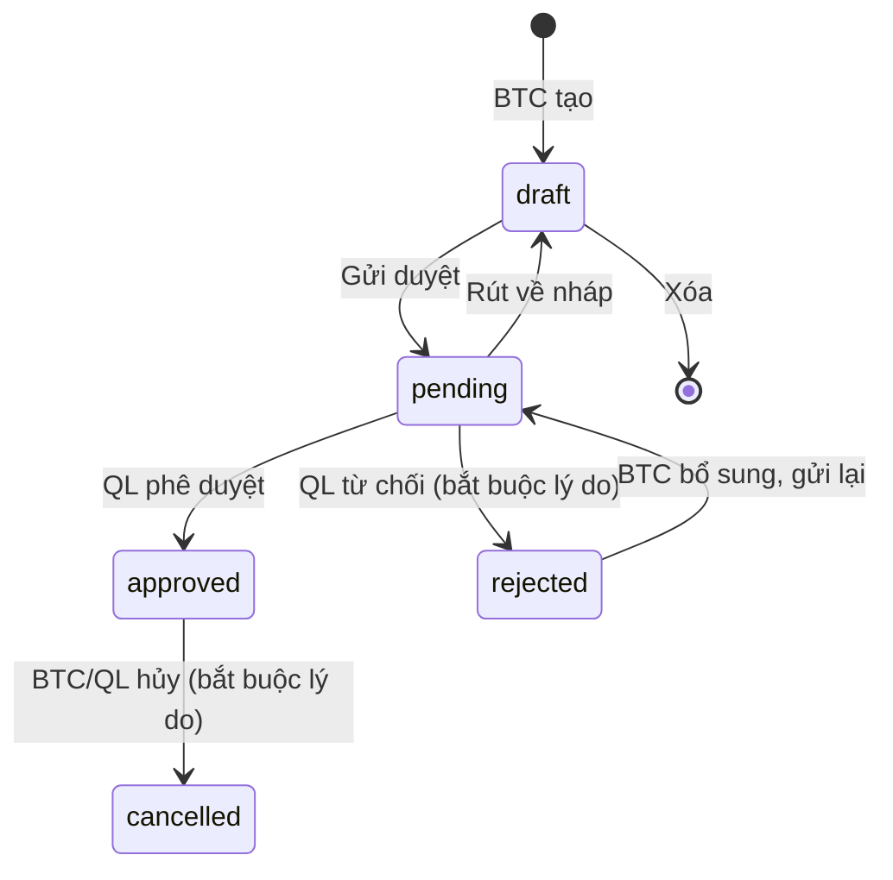
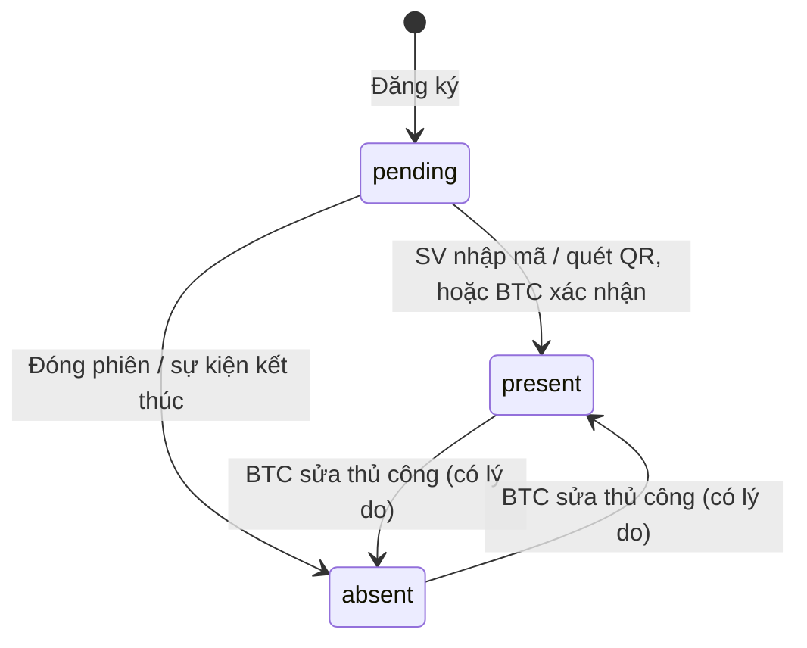

# Thiết kế cơ sở dữ liệu – NEU Events

CSDL SQLite, file `data/neu-events.db`, lược đồ tại `db/schema.sql`. Thời gian lưu dạng chuỗi `YYYY-MM-DD HH:MM:SS` (giờ máy chủ) nên so sánh chuỗi = so sánh thời gian.

## 1. Sơ đồ quan hệ (ERD)

> Sơ đồ viết bằng Mermaid – xem trực tiếp trên GitHub/VS Code (extension *Markdown Preview Mermaid*) hoặc dán vào <https://mermaid.live>.

## 2. Mô tả bảng

| Bảng | Ý nghĩa | Ràng buộc đáng chú ý |
|---|---|---|
| `units` | Khoa, viện, phòng ban, CLB | `name` duy nhất |
| `categories` | Loại sự kiện (Học thuật, Nghề nghiệp, Cộng đồng, Văn hóa) | `color` dùng cho biểu đồ |
| `users` | Tài khoản 3 vai trò | `code`, `email` duy nhất; `role` CHECK |
| `events` | Hồ sơ / sự kiện | `status` CHECK 5 giá trị |
| `event_agenda` | Các mốc chương trình | Xóa theo sự kiện (CASCADE) |
| `event_files` | File đính kèm, lưu ở `uploads/` | CASCADE |
| `registrations` | Lượt đăng ký + kết quả điểm danh | `UNIQUE(event_id, user_id)` – đăng ký lại dùng lại bản ghi |
| `attendance_sessions` | Phiên điểm danh (mã, thời gian hiệu lực) | Phiên mở: `closed_at IS NULL` |
| `reviews` | Đánh giá 1–5 sao | `UNIQUE(event_id, user_id)`; `rating` CHECK 1–5 |
| `notifications` | Thông báo trong hệ thống | Chỉ mục `(user_id, is_read)` |
| `audit_logs` | Nhật ký thao tác (duyệt, từ chối, hủy, sửa điểm danh…) | `reason` lưu lý do bắt buộc |
| `password_resets` | Mã đặt lại mật khẩu 6 số, hạn 15 phút | `used_at` đánh dấu đã dùng |

## 3. Vòng đời trạng thái

**Hồ sơ sự kiện (`events.status`)**

**Điểm danh (`registrations.attendance`)**

## 4. Các chỉ số báo cáo (truy vấn từ bảng)

| Chỉ số | Cách tính |
|---|---|
| Số sự kiện | `events.status = 'approved'` có `start_at` trong khoảng lọc |
| Lượt đăng ký | `registrations.status = 'registered'` của các sự kiện trên |
| Lượt tham dự | như trên và `attendance = 'present'` |
| Tỷ lệ tham dự | tham dự / đăng ký, chỉ tính sự kiện có `end_at < hiện tại` |
| Theo tuần | nhóm `registered_at` (đăng ký) và `checked_in_at` (tham dự) theo tuần bắt đầu thứ Hai |
| Đánh giá TB | `AVG(reviews.rating)` |

## Bổ sung

- `events.level` (`truong` | `khoa` | `clb`), `events.points` – cấp chương trình và điểm hoạt động.
- `registrations.checked_out_at`, `checkout_method`, `points_awarded` – check-out và điểm đã cộng.
- `attendance_sessions.kind` (`checkin` | `checkout`); `reviews.is_anonymous`.
- `point_submissions` (id, event_id UNIQUE, submitted_by, submitted_at, member_count, points, note, status `pending|approved|rejected`, reviewed_by, reviewed_at, review_note) – danh sách nhận điểm BTC gửi Đơn vị quản lý.

Cơ sở dữ liệu cũ được tự động bổ sung cột khi khởi động (`db/database.js → migrate`).
